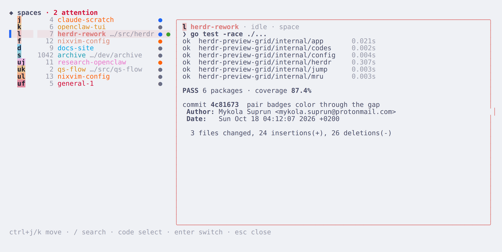
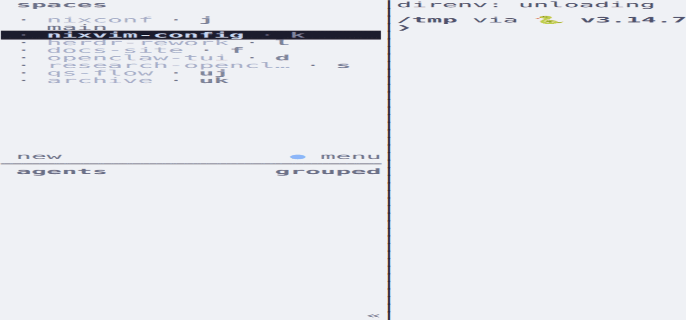
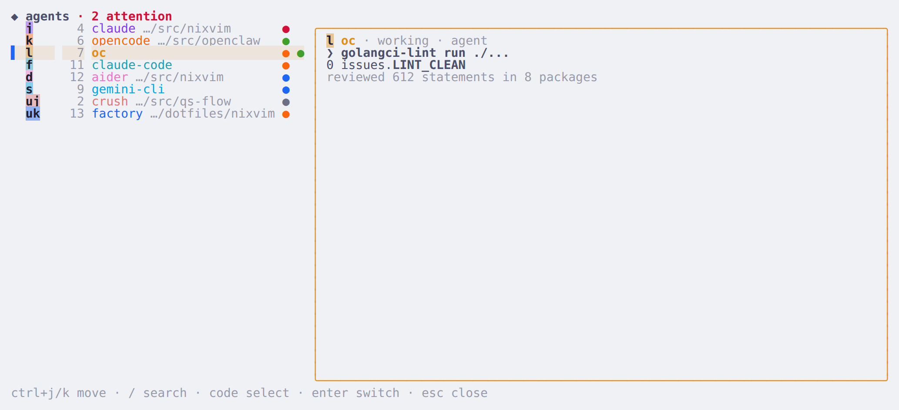

# herdr-vimnav

**Master-detail switcher for [herdr](https://herdr.dev)** — pick a space or
agent from a live, preformatted list and watch its pane while you decide.

<p align="center"></p>

A herdr plugin: a **master-detail switcher** for spaces (workspaces) and
agents — a list of items with the selected one's live pane preview
alongside — plus **sidebar jump codes**: every space/agent row in the
native sidebar carries a code badge (kept in sync automatically), and
`prefix+f` opens a tiny popup that jumps to whatever code you type.

Inside the picker: walk the list with `ctrl+j/k` (or arrows), fuzzy-search
with `/`, and type a code to select its item — `enter` switches.

```sh
herdr plugin install MykolaSuprun/herdr-vimnav
```

The plugin registers as `preview-grid`; bind `prefix+w` / `prefix+a` (see
[Install](#install)).

## Demo

**Sidebar jump codes, end to end** — badges auto-populate on every layout
change; `prefix+w` opens the picker (its codes match the sidebar
one-to-one); typing a code selects, `enter` switches:

<p align="center"></p>

`prefix+a` — agents, with the same layout and preview panel:

<p align="center"></p>

The screenshots and the GIF are rendered from a throwaway herdr session
(and `tools/demo-server` for the static shots) — no live workspace names
are ever published. To regenerate: see [Development](#development).

## Features

- **Master list + live preview panel** — aligned columns per row: code badge
  exactly as wide as the code (every glyph centered in its own cell),
  right-aligned dim number, label, dim cwd segment (dedupes identical
  labels), and a pinned right rail (status dot + focused flag); the selected
  row carries a faint wash of its own accent hue and the header sums
  attention (`◆ spaces 13 · 2 attention`). The right panel shows the selected
  item's live pane preview full-height.
- **Colored ANSI previews** — the preview renders the pane's real colors (SGR
  kept; cursor/erase/OSC sequences stripped), so diffs, trees, and highlighted
  output are recognizable at a glance. Each line is reset-terminated so colors
  never bleed into the panel frame.
- **Cursor starts on the focused item** — the picker opens showing where you
  are; the focused row carries a green `●`, the cursor row a `▌` marker.
- **Instant selection preview** — moving the selection re-reads the selected
  pane immediately (on top of the periodic snapshot refresh), so the panel
  never lags behind the highlight.
- **The host space previews the pane behind the picker** — herdr focuses the
  overlay pane itself while it is open, so the picker resolves the space it
  runs in to the pane *underneath* (via its launch context), never previewing
  itself.
- **Per-item identity accent** — a stable hash of the item key picks a
  Catppuccin latte hue (saturated, readable on light terminals): the detail
  border is tinted, the jump code renders as a solid accent badge, and the
  label/title use the accent — so a space keeps the same color across opens
  (learnable landmarks).
- **Status dots** — each row starts with a `●` colored by state: peach
  `working`, red `blocked`, green `done`, blue `idle`, gray unknown/none.
- **Walk the list**: `ctrl+j/k` plus `↓`/`↑`, `pgup`/`pgdn`, `ctrl+u`/`ctrl+d`,
  `home`/`end`. Bare letters are reserved for codes (the code letters
  themselves are `j k l f d s`, which is why stepping uses ctrl chords).
- **Fuzzy search**: `/` opens the search field; type to filter, `esc` clears.
- **Select-only jump codes** — every row shows a 1–2 letter code from
  `jklfds`. Prefix-free by construction (six singles `j k l f d s`, then
  pairs `uj uk ul …`), so a code completes in one keystroke and fires
  immediately — no ambiguity timeout. Typing a complete code moves the
  selection (the preview follows); `backspace` edits the code buffer;
  `enter` commits the switch. A code alone never focuses anything.
- **Sidebar jump codes** — the native sidebar's spaces/agents rows show a
  `$jump` badge per row (reported via `report_metadata`, source `user:jumpd`).
  Codes re-sync automatically on every layout change (create/close/move/rename/
  reorder/agent-detect) through the plugin's `[[startup]]` + `[[events]]`
  hooks — no daemon, no manual step. `prefix+f` opens a tiny popup: type a
  code → focus moves; `esc` cancels, `backspace` edits. Same prefix-free
  scheme as the picker.
- **Priority order** — attention-first: agents that are `blocked`
  (approval/question dialog) or `done` (finished but not yet viewed) lead,
  both MRU-ordered; everything else — idle, working, unknown — interleaves
  in plain most-recently-used order. Recency comes from herdr's own
  `workspace.focused`/`pane.focused` event hooks (all navigation from any
  client is recorded, even while the picker is closed). `sort = "usage"` /
  `"natural"` restore the old orders. Status dots keep showing each state.
- **Theming** — Catppuccin latte-family palette; the detail border follows the
  selected item's identity accent.

## Requirements

- herdr `>= 0.9.3` (plugin pane + socket API, `report_metadata`, `[[startup]]` /
  `[[events]]` manifest hooks; verified against 0.9.3)
- Go 1.26+ **only at install/build time** (the released binary is static, `CGO_ENABLED=0`)

## Install

From GitHub (builds automatically at install time — needs Go, see
[Requirements](#requirements)):

```sh
herdr plugin install MykolaSuprun/herdr-vimnav
```

Local development (no build step at link time; the plugin falls back to
`go run` if `./bin/herdr-preview-grid` is missing):

```sh
git clone https://github.com/MykolaSuprun/herdr-vimnav.git
cd herdr-vimnav
CGO_ENABLED=0 go build -o bin/herdr-preview-grid ./cmd/herdr-preview-grid
herdr plugin link "$PWD"
```

Then bind keys in your herdr config (plugin bindings live there, not in Nix):

```toml
[[keys.command]]
key = "prefix+w"
type = "plugin_action"
command = "preview-grid.spaces"
description = "switch space (preview grid)"

[[keys.command]]
key = "prefix+a"
type = "plugin_action"
command = "preview-grid.agents"
description = "switch agent (preview grid)"

# Sidebar jump codes (badges are maintained by the plugin's hooks)
[[keys.command]]
key = "prefix+f"
type = "popup"
command = "/absolute/path/to/herdr-preview-grid/bin/herdr-preview-grid jump"
width = 44
height = 3
description = "jump to sidebar code"
```

Reload with `prefix+shift+r` (or `herdr server reload-config`).

## Configuration

On first run, copy `config.example.toml` into the plugin config dir
(`herdr plugin config-dir preview-grid` → `config.toml`):

| Key | Default | Meaning |
|---|---|---|
| `charset` | `jklfds` | Letters used for jump codes (1-letter for the first N rows, then pairs) |
| `master_width` | `0` (auto) | Master list width in columns; `0` = about a third of the terminal, clamped to 28–42 |
| `preview` | `true` | Render the selected item's live pane snapshot in the detail panel |
| `refresh_ms` | `1000` | Snapshot refresh interval while open, floored to 100ms (`≤0` → default; selection moves re-read immediately on top) |
| `sort` | `priority` | `"priority"` (awaiting-input first, then MRU), `"usage"` (MRU), or `"natural"` (herdr order) |

Unknown keys are ignored, so tile-era leftovers (`preview_lines`,
`preview_scale`, `tile_min_width`, `code_timeout_ms`) from old configs are
harmless no-ops — nothing in the current code reads them.

## Keys

| Key | Action |
|---|---|
| `ctrl+j/k`, `↓`/`↑` | move selection |
| `pgup`/`pgdn`, `ctrl+u`/`ctrl+d` | page |
| `home` / `end` | first / last row |
| `/` | fuzzy search |
| `j k l f d s` (+ pairs) | select by jump code |
| `backspace` | edit code buffer (or search text) |
| `enter` | switch to the selected item |
| `esc` | clear search/filter, else close |
| `ctrl+c` | close |

Sidebar jump popup (bind e.g. `prefix+f` to
`…/bin/herdr-preview-grid jump` as a `popup`): type a sidebar code → focus
moves; `esc` cancels; `backspace` edits. Codes come from the same table as the
picker.

## How it works

Standard herdr plugin anatomy:

- `herdr-plugin.toml` declares two **actions** (`spaces`, `agents`) — actions
  run without a TTY, so they delegate to the matching **pane** entrypoints via
  `herdr plugin pane open` — and two **panes** (overlay placement) that run the
  Go binary.
- The binary talks to the running herdr server over `$HERDR_SOCKET_PATH`
  (newline-delimited JSON, one request per connection) for state
  (`workspace.list`, `pane.list`, `agent.list`), previews
  (`pane.read` with `format = "ansi"`), and focus (`workspace.focus`,
  `agent.focus`).
- MRU state is persisted to `$HERDR_PLUGIN_STATE_DIR/mru.json`; the sidebar
  badge table lives next to it in `jumpcodes.json`.
- `sync-codes` (the `[[startup]]` + layout `[[events]]` hook mode) re-lists
  the live layout, diffs against `jumpcodes.json`, and reports only changed
  rows as `$jump` metadata tokens (source `user:jumpd`) — badges follow every
  create/close/move/rename/reorder automatically, with no daemon.
- `jump` (the popup mode) resolves a typed code against the live layout and
  calls `workspace.focus` / `agent.focus`.

## Development

```sh
go build ./...
go vet ./...
go test ./...
CGO_ENABLED=0 go build -o bin/herdr-preview-grid ./cmd/herdr-preview-grid
```

Manual smoke test inside herdr: `herdr plugin action invoke preview-grid.spaces`.
Sidebar: add a throwaway space (`herdr workspace create --label tmp --cwd /tmp`)
and watch the badges re-space via the hooks, then close it; `herdr plugin log
list` shows the `sync-codes` runs.

UI work without a live session: `go run ./tools/demo-server /tmp/herdr-demo.sock`
serves a curated layout; point `HERDR_SOCKET_PATH` at the socket and run the
binary (or open the plugin linked from this checkout) against it.

Screenshots/GIF: run a throwaway herdr server under an isolated
`XDG_CONFIG_HOME`/`XDG_STATE_HOME` inside tmux, `herdr plugin link` the
checkout, seed demo workspaces via `herdr workspace create` (hooks populate
the badges), drive the keys with `tmux send-keys`, and capture each beat with
`tmux capture-pane -e`; render the SGR through any ANSI→HTML converter,
screenshot headless Chromium, and assemble with ImageMagick (`-delay` per
frame, `-layers Optimize`). The popup jump mode renders only on attached
clients — the GIF therefore demonstrates the picker flow.

## License

MIT — see [LICENSE](LICENSE).
